<p align="center">
  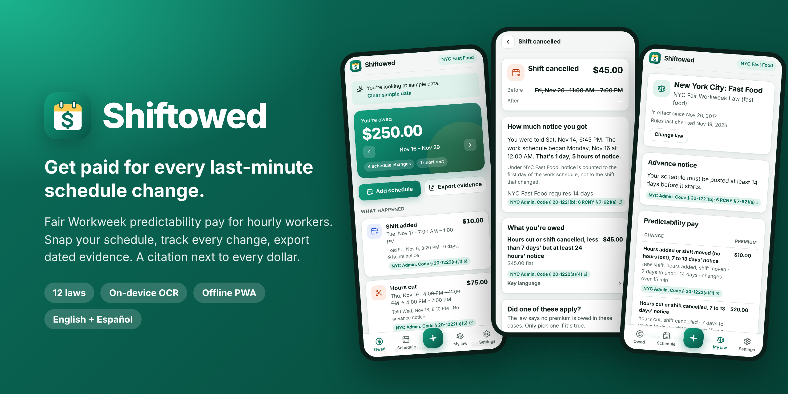
</p>

<p align="center">
  <a href="https://github.com/lobojoel2003/Shiftowed/actions/workflows/ci.yml"></a>
  <a href="https://github.com/lobojoel2003/Shiftowed/actions/workflows/codeql.yml"></a>
  <a href="https://github.com/lobojoel2003/Shiftowed/releases/latest"></a>
  <a href="LICENSE"></a>
  <a href="packages/rules/LICENSE"></a>
  
</p>

# Shiftowed

**A Fair Workweek pay calculator for hourly workers.** When your employer adds, cuts or moves a shift on short
notice, Fair Workweek laws say they owe you extra "predictability pay". Shiftowed keeps a timestamped record of every
version of your schedule, finds every change that earns a premium under your city's law, adds up what you're owed this
pay period, and exports a dated evidence log you can bring to the labor office or a worker center. There's a citation
next to every dollar.

It runs entirely on your phone. No account, no server, no tracking.

> [!NOTE]
> Shiftowed is a calculator, not legal advice. It shows its work and links to the law so you, a worker center or the
> enforcing agency can check it.

## Contents

- [Why this exists](#why-this-exists)
- [What it does](#what-it-does)
- [Supported laws](#supported-laws)
- [How it works](#how-it-works)
- [Get started](#get-started)
- [The evidence log](#the-evidence-log)
- [Privacy and security](#privacy-and-security)
- [Development](#development)
- [Releases, versions and build numbers](#releases-versions-and-build-numbers)
- [Contributing](#contributing)
- [Get help](#get-help)
- [License](#license)

## Why this exists

Fair Workweek laws require large employers in fast food, retail, warehouses and hospitality to post schedules in
advance, usually 14 days. When a shift is added, cut or moved after that, the employer owes a premium. In New York City
fast food that's $10 to $75 per change and $100 for a "clopening"; in Seattle and Oregon it's an hour of pay, or
half-time for every hour you lose.

Most workers never collect it, because proving a violation means remembering every schedule change and exactly when it
was posted. The tools that track this are employer-side compliance products sold per location. Shiftowed is the
worker's side of that ledger.

## What it does

<table>
  <tr>
    <td width="25%">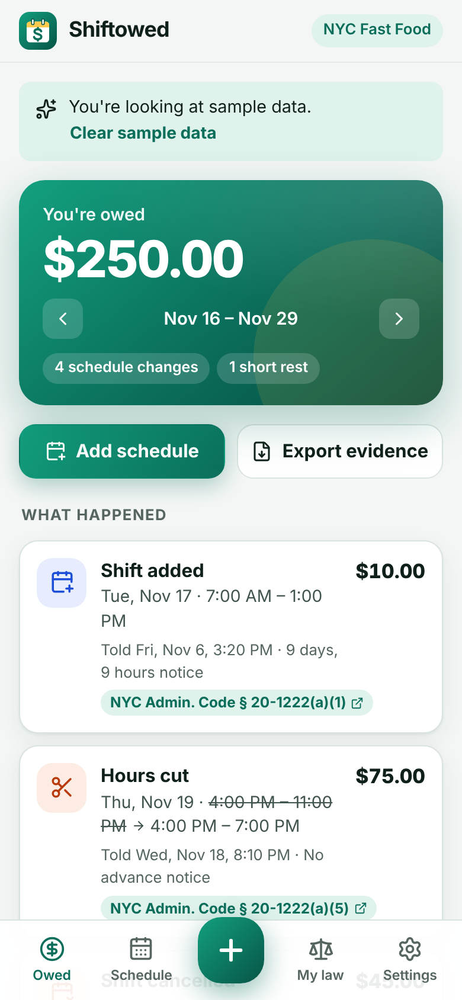</td>
    <td width="25%">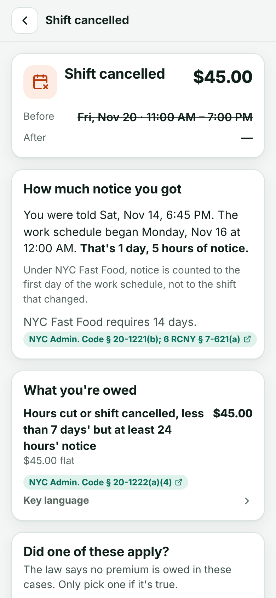</td>
    <td width="25%">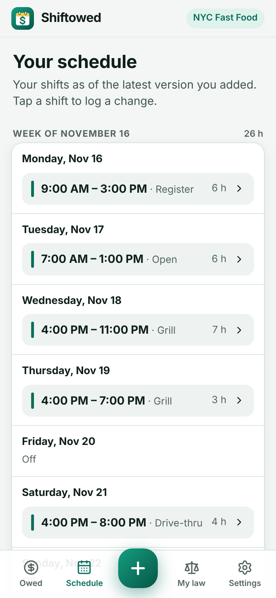</td>
    <td width="25%">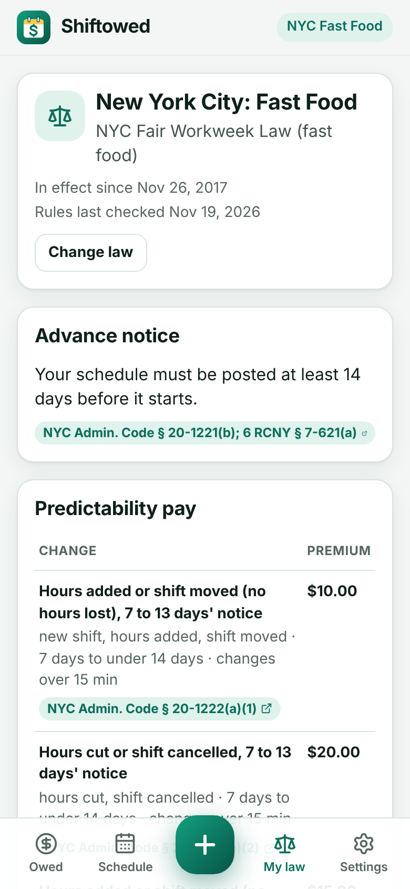</td>
  </tr>
  <tr>
    <td><b>Running total.</b> What you're owed this pay period, and every change behind it.</td>
    <td><b>Every dollar explained.</b> Notice given, the tier, the formula and the exact section of the law.</td>
    <td><b>Your schedule.</b> Tap any shift to log "sent home early", "asked to stay" or "cancelled".</td>
    <td><b>Your law.</b> Notice rules, premiums, exceptions, coverage and who to call.</td>
  </tr>
</table>

- **Snap or type your schedule.** Screenshot your scheduling app and Shiftowed reads it on your phone (Tesseract OCR in
  WebAssembly, list or grid layouts, light or dark screenshots), or type shifts in. You always review before saving.
- **Every version, timestamped.** Each version records when your employer posted it, and is chained to the previous one
  with a SHA-256 fingerprint, so later edits are visible.
- **Changes found and priced automatically.** Added, extended, moved, cut and cancelled shifts; short rest between shifts
  ("clopening"); schedules posted late. Each is priced under your law, with exceptions you can mark ("I asked for
  this", "I traded with a coworker") and a citation for each.
- **A running total per pay period**, weekly, every two weeks, twice a month or monthly.
- **One-tap evidence export:** a dated PDF with every finding, citation, version fingerprint and the activity log, plus
  CSV for spreadsheets and a full JSON backup.
- **Offline-first PWA.** Install it to your home screen and it works with no signal, including screenshot reading.
- **English and Spanish.**

<p align="center">
  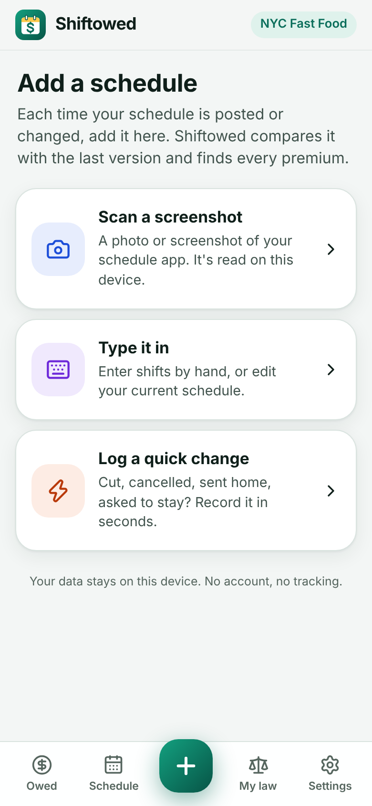
  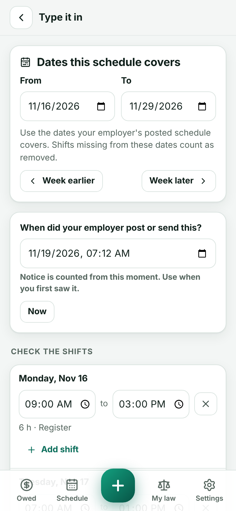
  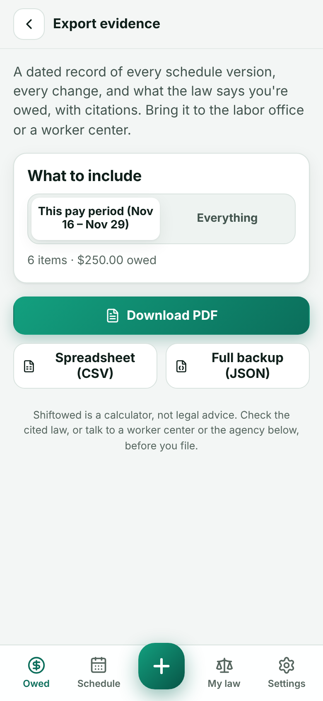
  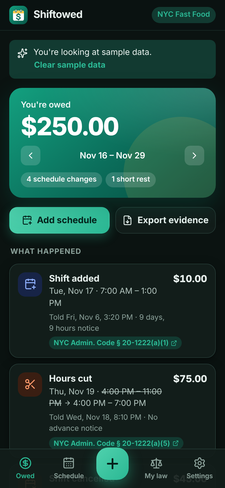
</p>

## Supported laws

Twelve laws, each in its own open-data file in [`packages/rules/rules/`](packages/rules/rules), checked against the
enacted ordinances, codes and agency rules on 2026-11-19.

| Law                                                                              | Advance notice | Schedule-change premiums                                                   | Rest between shifts                                    |
| -------------------------------------------------------------------------------- | -------------- | -------------------------------------------------------------------------- | ------------------------------------------------------ |
| [New York City, fast food](packages/rules/rules/us-ny-nyc-fast-food.json)        | 14 days        | $10 / $15 added or moved; $20 / $45 / $75 cut or cancelled                 | $100 "clopening" (under 11 h)                          |
| [New York City, retail](packages/rules/rules/us-ny-nyc-retail.json)              | 72 hours       | No premium; cancelling or requiring extra hours inside 72 h is a violation | None                                                   |
| [Philadelphia](packages/rules/rules/us-pa-philadelphia.json)                     | 14 days        | 1 hour of pay added or moved; half-time per hour lost                      | $40 (under 9 h)                                        |
| [Oregon (statewide)](packages/rules/rules/us-or-oregon.json)                     | 14 days        | 1 hour of pay added or moved; half-time per hour lost                      | Time and a half inside 10 h                            |
| [Seattle](packages/rules/rules/us-wa-seattle.json)                               | 14 days        | 1 hour of pay (pro-rated under an hour); half-time per hour lost           | Time and a half inside 10 h                            |
| [Chicago](packages/rules/rules/us-il-chicago.json)                               | 14 days        | 1 hour of pay; half-time per hour lost if cut with under 24 h notice       | 1.25x the whole shift (under 10 h)                     |
| [Evanston](packages/rules/rules/us-il-evanston.json)                             | 14 days        | 1 hour of pay; cut with under 24 h notice: shift hours, up to 4            | Time and a half inside 11 h                            |
| [Los Angeles (city), retail](packages/rules/rules/us-ca-los-angeles.json)        | 14 days        | 1 hour of pay added or moved; half-time per hour lost                      | Time and a half on the whole second shift (under 10 h) |
| [Los Angeles County, retail](packages/rules/rules/us-ca-los-angeles-county.json) | 14 days        | 1 hour of pay added or moved; half-time per hour lost                      | Time and a half on the whole second shift (under 10 h) |
| [San Francisco, formula retail](packages/rules/rules/us-ca-san-francisco.json)   | 2 weeks        | 1 hour of pay (1 to 6 days' notice); 2 or 4 hours (under 24 h)             | None                                                   |
| [Emeryville](packages/rules/rules/us-ca-emeryville.json)                         | 14 days        | 1 hour of pay; cut with under 24 h notice: shift hours, up to 4            | Time and a half inside 11 h                            |
| [Berkeley](packages/rules/rules/us-ca-berkeley.json)                             | 14 days        | 1 hour of pay; cut with under 24 h notice: hours cut, up to 4              | Time and a half inside 11 h                            |

Each file also records coverage thresholds, exceptions, how small a change counts, whether notice is measured to the
shift or to the first day of the schedule, the enforcing agency and every source. See each law's `notes` for how
Shiftowed applies it.

## How it works

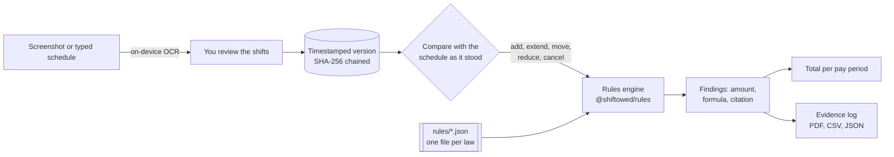

1. **Versions, not snapshots.** Each schedule version covers a date range and replaces only those dates, so posting next
   week's schedule never "cancels" this week.
2. **Matching.** Old and new shifts are paired by identical times, then by overlap, then by day, then as moves of the
   same length, and classified as add, extend, move, reduce or cancel.
3. **Notice.** Measured from when the employer posted or sent the change to the start of the affected shift or, where
   the law says so (for example NYC's 6 RCNY § 7-622), to 12:00 a.m. on the first day of the work schedule.
4. **Pricing.** The law's rules are matched by change type, notice window and minimum change size. Money is computed in
   whole cents, and all time math is daylight-saving aware in the law's time zone.

The engine is a separate, dependency-free MIT library, [`@shiftowed/rules`](packages/rules), with a CLI for worker
centers and advocates:

```bash
npx shiftowed-rules evaluate us-wa-seattle versions.json --rate 20
```

## Get started

### Use it

- **In your browser:** <https://lobojoel2003.github.io/Shiftowed/>. On your phone, choose **Add to Home Screen** to install
  it.
- **Try it without your data:** tap **Explore with sample data** on the first screen.
- **Self-host:** download `shiftowed-pwa-vX.Y.Z.zip` from the [latest release](https://github.com/lobojoel2003/Shiftowed/releases/latest)
  and serve the folder from any static web host over HTTPS.

### Run it locally

Requires Node.js 22 or newer.

```bash
git clone https://github.com/lobojoel2003/Shiftowed.git
cd Shiftowed
npm install
npm run dev
```

Open <http://localhost:5173>.

## The evidence log

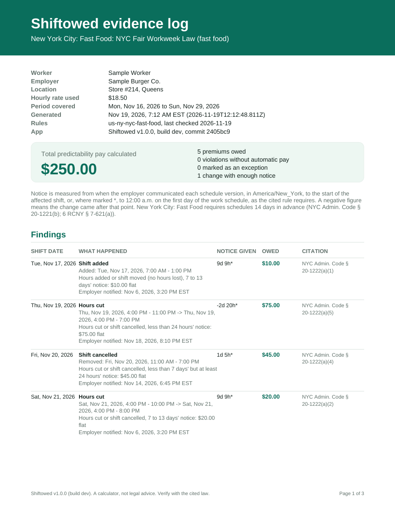

The PDF export is designed to be handed to an investigator:

- your details (optional), the law, the hourly rate used and the period covered
- the total, and every finding with the shift before and after, when the employer told you, the notice given, the
  premium, the formula and the citation
- links to every source cited
- every schedule version as you received it, with its SHA-256 fingerprint and the fingerprint of the screenshot it came
  from
- the app's activity log (edits, deletions, exceptions you marked)
- optionally, the screenshots themselves
- the app version and build number that produced it

<br clear="right">

## Privacy and security

- Everything stays on your device in IndexedDB. Shiftowed has no backend, no accounts, no analytics and no third-party
  requests.
- Screenshots are read on the device. The OCR engine and English model are served by the app itself, not a CDN.
- The production build ships a strict Content-Security-Policy that only allows the app's own origin.
- Backups are plain JSON files that you control.

Report vulnerabilities privately; see [SECURITY.md](SECURITY.md).

## Development

```text
packages/
  rules/   @shiftowed/rules: open-data laws, JSON Schema, engine, CLI  (MIT)
  app/     Shiftowed PWA: React 19, Vite, IndexedDB, Tesseract, jsPDF  (GPL-3.0-or-later)
scripts/   versioning, release packaging, screenshots, icons
docs/      images used in this README
```

| Command                 | What it does                                                    |
| ----------------------- | --------------------------------------------------------------- |
| `npm run dev`           | Start the app with hot reload                                   |
| `npm run check`         | Format check, lint, type check, rules validation and unit tests |
| `npm test`              | Unit tests for both packages                                    |
| `npm run test:coverage` | Unit tests with coverage reports                                |
| `npm run build`         | Build the rules library and the app                             |
| `npm run e2e`           | Playwright end-to-end tests against the production build        |
| `npm run screenshots`   | Regenerate the images in `docs/images` from the sample data     |

The test suite covers the engine (time zones and DST, diffing, pricing, every amount type), a scenario test for every
law, schema validation of every rules file, the app's storage, hashing, backup and export code, and end-to-end runs of
the full worker journey, real OCR on a rendered schedule, offline mode, accessibility (axe) and layout in both
languages.

## Releases, versions and build numbers

- **Semantic Versioning.** The app, the rules library and the repository share one version and one `vX.Y.Z` tag.
- **Build numbers.** Every CI build stamps the app with the GitHub Actions run number, short commit hash and build date.
  You'll find them in **Settings > About** and on every evidence log, for example `v1.0.0 (build 57, 1a2b3c4)`.
- **CI** ([`ci.yml`](.github/workflows/ci.yml)) runs format, lint, type checks, rules validation and unit tests on
  Node 22 and 24, builds the app and library, smoke-tests the packed CLI, and runs the Playwright suite.
- **Release** ([`release.yml`](.github/workflows/release.yml)) runs on every `v*` tag: it verifies the tag against the
  package versions and changelog, builds, and publishes a GitHub release with the PWA zip, the npm tarball, the rules
  data zip and SHA-256 checksums.
- **Deploy** ([`pages.yml`](.github/workflows/pages.yml)) publishes `main` to GitHub Pages.
- **Version bump** ([`version-bump.yml`](.github/workflows/version-bump.yml)) is a one-click release: pick patch, minor
  or major and it bumps, tags and releases.
- Also: CodeQL, dependency review on pull requests, and Dependabot for npm and Actions.

Details are in [RELEASING.md](RELEASING.md) and every change is in the [CHANGELOG](CHANGELOG.md).

## Contributing

The most valuable contribution is keeping the laws right. Each law is a JSON file with a citation and primary-source
link for every number, so you don't need to write code to fix one. See [CONTRIBUTING.md](CONTRIBUTING.md), or open a
[rules correction issue](https://github.com/lobojoel2003/Shiftowed/issues/new?template=rules-correction.yml).

## Get help

If you think you're owed predictability pay, the agency that enforces your law can help. Fair Workweek laws also
protect workers from retaliation for using these rights; ask the agency how that applies to you.

| Where you work     | Agency                                  | Contact                                                                                                                                                 |
| ------------------ | --------------------------------------- | ------------------------------------------------------------------------------------------------------------------------------------------------------- |
| New York City      | Dept. of Consumer and Worker Protection | Call 311; [file a complaint](https://www.nyc.gov/site/dca/workers/workersrights/file-workplace-complaint.page)                                          |
| Philadelphia       | Office of Worker Protections            | 215-686-0802; [report a violation](https://www.phila.gov/services/working-jobs/worker-protections/wage-protections/report-a-fair-workweek-violation/)   |
| Oregon             | Bureau of Labor and Industries          | 971-245-3844; [file a complaint](https://www.oregon.gov/boli/workers/pages/complaint.aspx)                                                              |
| Seattle            | Office of Labor Standards               | 206-256-5297; [file a complaint](https://www.seattle.gov/laborstandards/investigations/file-a-complaint)                                                |
| Chicago            | Office of Labor Standards               | 311 or 312-744-2211; [CHI 311](https://311.chicago.gov/s/service-request?language=en_US)                                                                |
| Evanston           | City of Evanston                        | [Fair Workweek page](https://www.cityofevanston.org/business/fair_workweek.php)                                                                         |
| Los Angeles (city) | Office of Wage Standards                | 844-924-3752; [Fair Work Week](https://wagesla.lacity.gov/fair-work-week-information)                                                                   |
| Los Angeles County | Dept. of Consumer and Business Affairs  | 800-593-8222; [Fair Workweek](https://dcba.lacounty.gov/fairworkweek/)                                                                                  |
| San Francisco      | Office of Labor Standards Enforcement   | 415-554-6461; [report a problem](https://sf.gov/report-problem-your-employer)                                                                           |
| Emeryville         | City of Emeryville                      | 510-596-4351; [Fair Workweek](https://www.emeryville.org/Services/Business/Permits-Regulations/Fair-Workweek-Ordinance)                                 |
| Berkeley           | Labor Standards & Enforcement           | 510-981-5400; [workforce standards](https://berkeleyca.gov/doing-business/operating-berkeley/employer-requirements/workforce-standards-and-enforcement) |

A local worker center or legal aid organization can also help you decide what to do.

## License

- The app (`packages/app` and everything not listed below) is licensed under the
  [GNU General Public License v3.0 or later](LICENSE).
- The rules library and data (`packages/rules`) are licensed under the [MIT License](packages/rules/LICENSE), so
  anyone, including employers' compliance tools, can reuse the laws as open data.

Built with [React](https://react.dev), [Vite](https://vite.dev), [Tesseract.js](https://github.com/naptha/tesseract.js),
[jsPDF](https://github.com/parallax/jsPDF), [idb](https://github.com/jakearchibald/idb),
[Lucide](https://lucide.dev) and [Workbox](https://developer.chrome.com/docs/workbox).
